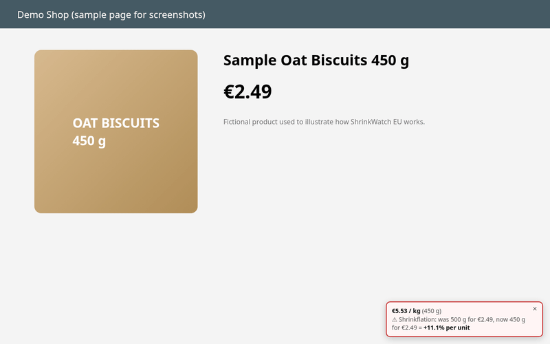

# ShrinkWatch EU

[](https://github.com/emirmrkaljevic/shrinkwatch-eu/releases/latest) [](docs/shops.md) [](https://emirmrkaljevic.github.io/shrinkwatch-eu/) [](LICENSE) [](https://alternativeto.net/software/shrinkwatch-eu/about/?utm_source=badge&utm_medium=referral)

<p align="center"><a href="https://skintoscan.com/#packages"></a><br><sub>If you find this useful, you can support me by getting a SkinToScan pack, my other project. It's a one-time purchase that directly funds my open-source work.</sub></p>
<p align="center"><a href="https://skintoscan.com/checkout/?add-to-cart=138"></a> <a href="https://skintoscan.com/checkout/?add-to-cart=139"></a> <a href="https://skintoscan.com/checkout/?add-to-cart=140"></a></p>

**See the real price per kg or litre on your supermarket web shop, and get a warning when your usual product quietly shrinks.**

> "Was 500 g for €2.00, now 450 g for €2.00 = **+11.1% per kg**"



## What it does for you

- **No more mental math.** Every product page shows the price per kg, litre or piece, so you can compare packs of different sizes at a glance.
- **Catches shrinkflation.** It remembers the pack size and price you saw before. When the same product comes back smaller for the same money, you get a warning.
- **Private.** No account, no server, no tracking. Your history stays only in your browser.
- **Free and open source** (MIT). Works in Chrome, Edge, Brave and Firefox.

## Install in 1 minute

The extension is not in the browser stores yet, so you install it from a zip file. It takes about a minute.

**Chrome, Edge or Brave**

1. Download `shrinkwatch-chrome-*.zip` from the [latest release](https://github.com/emirmrkaljevic/shrinkwatch-eu/releases/latest) and unzip it.
2. Open `chrome://extensions` (in Edge: `edge://extensions`).
3. Turn on **Developer mode** (top right in Chrome, bottom left in Edge).
4. Click **Load unpacked** and choose the unzipped folder.
5. Open a product page on a supported shop. The badge appears next to the price.

**Firefox**

1. Download `shrinkwatch-firefox-*.zip` from the [latest release](https://github.com/emirmrkaljevic/shrinkwatch-eu/releases/latest).
2. Open `about:debugging#/runtime/this-firefox`.
3. Click **Load Temporary Add-on** and pick the zip.

Firefox keeps it only until the next restart. A permanent install will come with the Firefox Add-ons listing, which is planned along with Microsoft Edge Add-ons.

## Which shops work

71 grocery and drugstore web shops in 25 EU countries plus Serbia and Bosnia and Herzegovina. **66 of them are verified** on real product pages in a real browser. The other 5 (Intermarché, Cours U, Colruyt, Tesco Czechia and Coop Italy) are included but not verified yet, because their sites blocked the test browser or need a login to show prices. Full list with check results: [docs/shops.md](docs/shops.md).

- **Work right after install:** Konzum, Tommy, Mercator, Bingo, Maxi and Lidl (DE, AT, HR, SI, RS, BA). On Tommy category and search pages you also get unit prices on product tiles.
- **Other shops:** open the shop, click the ShrinkWatch icon and choose "Enable on this shop". The browser asks for access to that shop only.
- **Any other site:** "Check this page now" reads the current page once, without any standing permission.

## FAQ

**My shop is not listed.** Open a product page and click "Check this page now" in the popup. If that works, please [request the shop](https://github.com/emirmrkaljevic/shrinkwatch-eu/issues/new?template=shop-request.yml) so it can be added.

**The badge shows the wrong size or price.** Please [report it](https://github.com/emirmrkaljevic/shrinkwatch-eu/issues/new?template=wrong-result.yml) with the product link.

**Why does the popup ask for permission on some shops?** Only a few shops are enabled by default. Any other shop is switched on only when you click "Enable on this shop", so the extension never gets access to sites you don't use.

**Does it send my data anywhere?** No. Pack sizes and prices are stored only in your browser.

**Can I move my history to another browser?** Yes. In the popup, click "Back up or restore history" to export it as a JSON file, then import that file in the other browser.

**Is a shrinkflation warning proof?** No. It compares what this browser saw before with what the shop shows now. Shop data can be wrong, so check the pack before drawing conclusions.

## For developers

Every shop first uses the page's own schema.org `Product` data, then Open Graph tags, then a few CSS selectors.

### Build and test

```sh
npm ci
npm test        # unit tests (pack-size parsing, unit price, shrinkflation detection, real page fixtures)
npm run build   # dist/shrinkwatch-chrome-<version>.zip and dist/shrinkwatch-firefox-<version>.zip
```

Adding a shop: add an entry to `src/adapters.js`, save a product page as a fixture in `test/fixtures/`, and add a test in `test/extract.test.js`.

### How shrinkflation is detected

For each product (keyed by EAN/SKU or URL) the extension keeps a short local history of pack size and price. When you see a product again with a smaller pack and a higher price per unit than before, it shows a warning. A smaller pack that is proportionally cheaper is not flagged.

## Privacy

No data is collected or sent anywhere. See [PRIVACY.md](PRIVACY.md).

## Disclaimer

ShrinkWatch EU is an independent project. It is not affiliated with, endorsed by or sponsored by Konzum, Lidl, Kaufland, Mercator, Bingo, Spar, Tommy, Rewe, Tesco or any other retailer. Shop names are trademarks of their owners and are used only to describe compatibility. Unit prices are computed from the information shown on the page and may be wrong; always check the shop's own label.

## License

MIT
